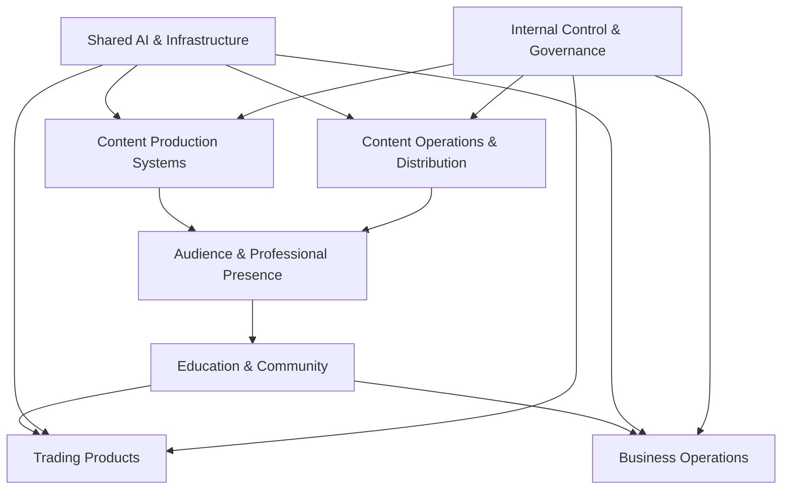

# SINA OS — Ecosystem Overview

SINA OS is a connected operating ecosystem spanning audience growth, education, trading tools, business operations, content production, distribution and shared infrastructure.

This public view shows system boundaries and relationships while intentionally omitting implementation recipes and private production details.

## Audience & Professional Presence

Public education, market commentary, podcasts, live sessions and professional channels create the top of the ecosystem.

## Education & Community

Structured programs, mentorship and private communities support deeper learning and ongoing participation.

## Trading Products

The SILO Trading Journal and analyst workflows support execution review, performance tracking, behavioral reflection and structured trading records.

## Business Operations

SIA coordinates lead, customer, payment, contract, subscription and follow-up workflows.

## Content Production Systems

A shared production layer supports recording-first educational visuals, repeatable short-form workflows, transcription, subtitle generation and post-production assistance.

Representative systems include Visual Deck, Moai Content System and SILO Speech Service.

## Content Operations & Distribution

Publishing systems coordinate preview, approval, scheduling and delivery across selected channels.

Representative systems include Content Distribution, Community Publisher, Newsroom, Live Orchestrator, Instagram Automation and Deep Link.

## Shared AI & Infrastructure

Reusable services provide model routing, speech processing, shared deployment primitives and common capabilities for multiple products.

## Internal Control & Governance

Project Hub provides a control plane for project state, repositories and next steps. Shora provides a structured multi-perspective decision process for selected product and business decisions.

## Public Ecosystem Map

## Active System Families

- SILO Trading Journal
- VIP Community / Analyst Platform
- SIA CRM & Accountant
- SINA Web Platform
- Visual Deck System
- Moai Content System
- SILO Speech Service
- Content Distribution System
- Community Publisher
- Community Newsroom
- Live Orchestrator
- Instagram Automation
- SINA Deep Link
- LLM Router
- Project Hub
- Shora
- Personal automation workflows
- LinkedIn Professional Channel workstream

## Design Principles

- Build from real operating pain.
- Keep systems independently useful but interoperable.
- Centralize reusable infrastructure.
- Deploy web applications and workers to the owned VPS in Docker containers, managed by Coolify when appropriate. Keep specialized Cloudflare DNS/edge integrations only where they add value; migrate existing production workloads only after verification.
- Keep human approval where judgment or brand risk matters.
- Prefer deterministic automation for repeatable operations.
- Keep public documentation outcome-focused and non-sensitive.
